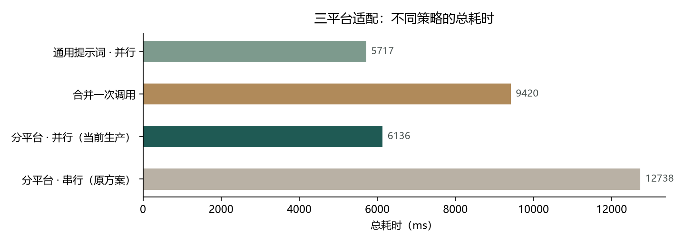
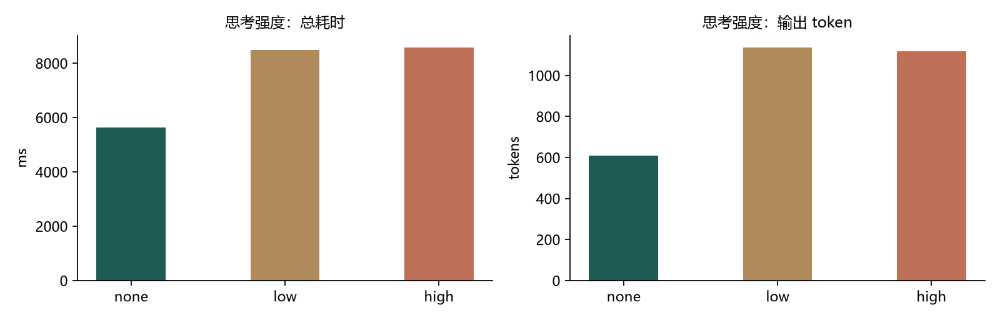

# 速度优化实验

- 时间：2026-10-29 11:52
- 环境：DeepSeek deepseek-flash，单机，同一批输入；短文为稿件 #1（201 字），长文为 #16（2102 字）
- 说明：适配每个平台包含一次改写 + 一次合规预检；总耗时含 HTTP 往返。

## 一、适配策略（三平台，短文）

| 策略 | 总耗时 | 改写/合规 | 输入/输出 token | 格式通过 | 形态特征 |
|---|---|---|---|---|---|
| 分平台 · 串行（原方案） | 12738.2 ms | 6951 / 4138 ms | 7262.5 / 1329.0 | 3/3 | 3/3 |
| 分平台 · 并行（当前生产） | 6136.5 ms | 6525 / 5263 ms | 7280.0 / 1353.5 | 3/3 | 3/3 |
| 合并一次调用 | 9420.1 ms | 0 / 4521 ms | 5500.5 / 1430.0 | 3/3 | 2/3 |
| 通用提示词 · 并行 | 5717.1 ms | 5763 / 4171 ms | 6972.5 / 1257.0 | 3/3 | 2/3 |

> 表中的「改写/合规」是各平台耗时之和；并行时它们重叠，求和会大于墙钟总耗时。

**怎么读**：

- 串行与并行的差别只在等待方式：并行时三个平台同时跑，总耗时接近最慢的那个；
- 合并一次调用减少了改写次数（3 次 → 1 次），但输出更长，容易变慢或被截断；
- 通用提示词（去掉平台形态要点）调用次数不变，所以速度不会明显变快，主要损失是形态。

## 二、长文（2102 字）

| 策略 | 总耗时 | 格式通过 | 各平台正文长度 |
|---|---|---|---|
| 长文 · 串行 | 21783.6 ms | 3/3 | [992, 2115, 656] |
| 长文 · 并行 | 9637.1 ms | 3/3 | [985, 2112, 775] |
| 长文 · 合并一次 | 17773.0 ms | 2/3 | [1022, 2154, 915] |

## 三、思考强度（审核同一段违规文案）

| 强度 | 总耗时 | 输入 token | 输出 token | 判定 | 命中规则 | 违规片段 |
|---|---|---|---|---|---|---|
| none | 5626.4 ms | 1329.0 | 608.5 | 2 | 5 | 7 |
| low | 8475.5 ms | 1354.0 | 1136.0 | 2 | 6 | 6 |
| high | 8577.8 ms | 1354.0 | 1116.5 | 2 | 6 | 7 |

**代价**：开思考会显著增加输出 token 与等待时间；在这类“按规则判定”的任务上，判定结果没有变好（同一段文案的等级与片段数一致）。真正的风险是长文时推理耗尽输出预算、正文为空（阶段 5 实测过），所以生产默认 `none`。

## 四、适配开思考（单平台）

| 强度 | 总耗时 | 输出 token | 格式 |
|---|---|---|---|
| none | 5313.4 ms | 359 | 1/1 |
| high | 7159.5 ms | 665 | 1/1 |

## 五、结论

1. **最快的改动是并行**：三平台短文 12.7 s → 6.1 s（约 52%），长文 21.8 s → 9.6 s；格式与形态都是 3/3。这是唯一“确定更快且不牺牲质量”的方案，已作为生产默认。
2. **分平台写一套提示词不会更快**：通用提示词 5.7 s vs 分平台 6.1 s，只快约 0.4 s，但形态特征 2/3 vs 3/3。分平台提示词的价值在形态质量，不在速度。
3. **合并一次调用不一定更快**：短文 9.4 s vs 并行 6.1 s，形态 2/3；长文 17.8 s、格式 2/3。少两次改写调用，但单次输出更长，容易变慢或被截断，不建议作为默认。
4. **关思考是正确默认**：none 5.6 s / 608 输出 token；low 8.5 s / 1136；high 8.6 s / 1116。等级都是 2，命中规则/片段只有轻微差异，没有明确质量收益；代价是约 50% 时间和接近 2 倍的输出 token，长文还可能因推理耗尽预算而空输出。适配开思考也从 5.3 s 升到 7.2 s、输出 token 359→665，格式不变。

> 思考强度的 low/high 相对快慢会受服务端排队影响，样本只有 2 轮；但“none 明显最快、token 最少”在两组里都成立。

> 质量代理“形态特征”只检查最容易识别的平台标志（小红书 emoji+标签、公众号无标签、抖音【画面】/【口播】），不等于完整的人工评分；结论以速度为主，质量只作方向性参考。
