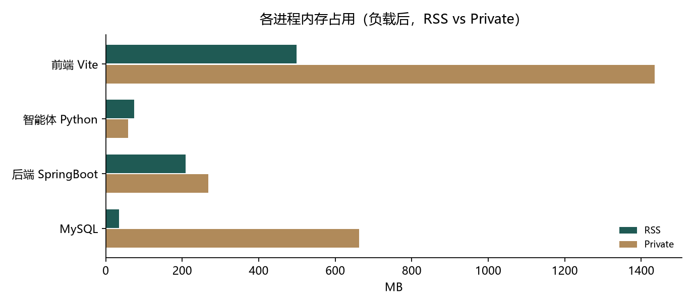
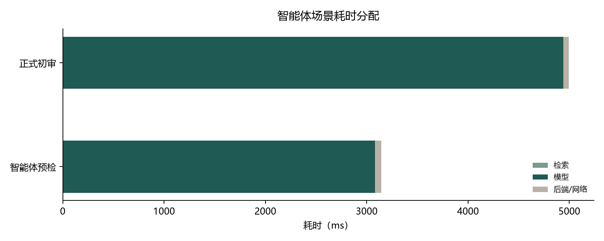
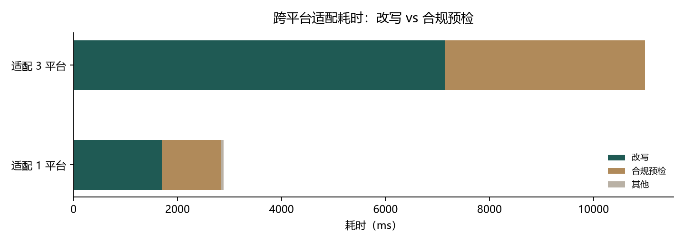

# 性能分析报告

- 生成时间：2026-10-29 11:55
- 环境：Windows 11 / JDK 17 / MySQL 8 / Python 3.11 / Node 22（前后端与 Agent 同机运行）
- 方式：先空载快照，再跑一轮代表性请求，最后再快照；耗时取 2-3 次的中位数。

## 一、内存占用

| 进程 | PID | RSS | Private | 说明 |
|---|---|---|---|---|
| 后端 SpringBoot | 92240 | 172.9 MB | 181.2 MB | JVM 堆 37.0 MB / 已提交 64.1 MB，Metaspace 49.5 MB，31 个线程 |
| 智能体 Python | 100248 | 75.1 MB | 61.1 MB | Python 解释器 + FastAPI/uvicorn + 模型 SDK；按请求处理，不加载本地大模型 |
| 前端 Vite（dev） | 25072 | 222.4 MB | 1445.3 MB | Vite 开发服务器；生产构建是静态文件，不需要 Node 常驻 |
| 前端 preview | 94224 | 98.1 MB | 114.9 MB | 生产构建的本地预览；与 dev 二选一，不计入合计 |
| MySQL | 7180 | 44.2 MB | 664.4 MB | InnoDB Buffer Pool 128.0 MB + performance_schema 约 230.9 MB + 连接/其他 |

**合计 RSS：约 514.6 MB**（RSS 含共享页，进程相加会略大于真实总量）。

> **怎么读这两个数**：MySQL 的 WorkingSet（RSS）只有 44.2 MB，但 Private 是 664.4 MB（Buffer Pool 128 MB + 连接/缓存），**以 Private 为准**；Vite 的 Private 1445.3 MB 是 Node 预留地址空间，RSS 222.4 MB 更接近实际，且生产构建是静态文件、不需要 Node 常驻。把 MySQL 的 Private 计入、Vite 只算 RSS 时，约 **1134.8 MB**。

> **生产预览模式**（关掉 dev、用 `npm run preview`）合计 RSS 约 **390.3 MB**；按 MySQL Private 校正约 **1010.5 MB**。

> **Maven 父进程**：上表的应用 JVM 是 `mvn spring-boot:run` fork 出来的子进程；Maven 自己还占
> **256.5 MB RSS / 403.3 MB Private**，不计入合计。打包后 `java -jar` 实测应用 204.3 MB，后端总额从约 429.5 MB
> 降到约 204.3 MB，这也是 `backend/start-low-memory.bat` 优先运行 jar 的原因。

> **MySQL 的 Private 去哪了**：`performance_schema.memory_summary_global_by_event_name` 显示
> performance_schema 约 230.9 MB、Buffer Pool 约 130.8 MB、link buffer 24.0 MB、log buffer 16.0 MB，
> 其余是连接、线程栈与分配器开销。改这些需要 `my.ini` + 重启，且会影响同实例上的其他库；
> 本轮只测量、未改配置，方案与命令见 `docs/性能与优化/性能优化实验.md`。

## 二、耗时分配

| 场景 | 总耗时 | 智能体 | 检索 | 定位 | 模型 | 后端/网络 |
|---|---|---|---|---|---|---|
| 登录（BCrypt + DB） | 134 ms | - | - | - | - | 全部 |
| 稿件列表（DB） | 108 ms | - | - | - | - | 全部 |
| 看板聚合（多次查询） | 59 ms | - | - | - | - | 全部 |
| 智能体预检 | 3183 ms | 3120 ms | 0 ms | 0 ms | 3120 ms | 63 ms |
| 正式初审 | 4516 ms | 4456 ms | 0 ms | 0 ms | 4455 ms | 61 ms |

### 跨平台适配

| 场景 | 总耗时 | 智能体 | 后端/网络 | 平台明细 |
|---|---|---|---|---|
| 适配 1 平台 | 2884 ms | 2836 ms | 47.6 ms | 小红书 2836ms（改写 1693 / 合规 1143） |
| 适配 3 平台 | 4816 ms | 4741 ms | 74.8 ms | 小红书 2903ms（改写 1810 / 合规 1092）；微信公众号 3354ms（改写 2255 / 合规 1099）；抖音 4736ms（改写 3085 / 合规 1650） |

> 如果开启了 MyBatis SQL 日志（`StdOutImpl`），每次查询都会往控制台打印 SQL 与结果行，会放大稿件列表等数据库接口的耗时；本项目的 `application.properties` 默认已关闭，排查时再打开。

## 三、结论

1. **耗时主要在模型调用**：预检的模型耗时 3120 ms，占总耗时 98%；检索只有 0 ms（规则向量有缓存时几乎为 0）。所以优化重点不是数据库，而是模型选择、输出长度与并发。
2. **适配已改为并行**：三平台短文从串行约 12.7 s 降到 6.1 s，长文从 21.8 s 降到 9.6 s；生产默认按平台并行。串行/并行、合并调用、通用提示词、思考强度的对比见 `docs/性能与优化/实验-速度优化.md`。
3. **内存大头是 MySQL 与后端 JVM**：MySQL Private 664.4 MB（performance_schema 约 230.9 MB、Buffer Pool 130.8 MB），后端 RSS 172.9 MB（堆 37.0 MB、Metaspace 49.5 MB，其余是线程栈、Code Cache、直接内存与 JVM 自身）；智能体只有 75.1 MB，因为它不加载本地模型；前端 222.4 MB 是 Vite 开发服务器，生产构建不需要 Node 常驻。按 RSS 合计 514.6 MB，按 MySQL Private 校正约 1134.8 MB。用 `mvn spring-boot:run` 时还有 256.5 MB 的 Maven 父进程；打包成 jar 后没有这一层。
4. **前端 Vite 的内存是开发期开销**：生产构建后是静态文件，不需要 Node 常驻；不要把它算进线上容量。

## 四、口径与局限

- RSS / Private 来自 Windows `Get-Process`，包含共享库；合计不是精确的独占内存。
- Java 堆数据来自 `jstat -gc`，Metaspace 与线程数来自 `jcmd`；Direct Buffer、Code Cache 计入 RSS 但未单列。
- 模型耗时受网络与服务端排队影响，单机单次测量只代表当前时段；本报告取中位数。
- 数据量是教学演示规模（十几篇稿件），数据库查询耗时不能外推到大数据量。
